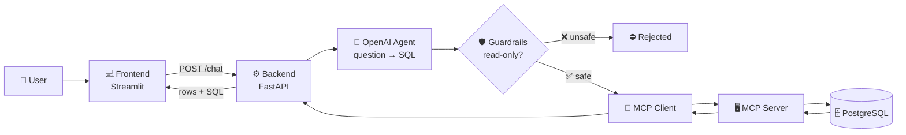

<div align="center">

# 💬 SIMPAISA Transaction Assistant

> **An LLM that bridges business and technical stakeholders.** Business teams ask questions in plain English; the assistant converts them into safe, read-only SQL, runs them through an MCP server, and returns clear answers — no SQL knowledge or analyst ticket needed.

**A natural-language-to-SQL assistant: ask questions about transactions in plain English and get answers straight from the database.**


</div>

---

## 📑 Table of contents

1. [Overview](#-overview)
2. [Use case](#-use-case)
3. [Architecture](#-architecture)
4. [Project structure](#-project-structure)
5. [Components in detail](#-components-in-detail)
6. [Why this tech stack](#-why-this-tech-stack)
7. [Entry points](#-entry-points)
8. [How to run](#-how-to-run)
9. [Example questions](#-example-questions)
10. [Security](#-security)

---

## 🧭 Overview

The SIMPAISA Transaction Assistant lets anyone query transaction data **without writing SQL**.

A user types a question in a chat window. An LLM converts it into a **read-only PostgreSQL query**, a guardrail layer checks that the query is safe, and an **MCP server** runs it against the database. The answer appears in the chat, together with the SQL that produced it.

---

## 🎯 Use case

**The problem:** Business, operations and finance teams constantly need quick numbers, such as transaction counts, success rates and operator breakdowns. Each request normally means writing SQL or waiting for the data team.

**The solution:** a self-service chat assistant that:

- answers ad-hoc data questions in seconds
- needs no SQL knowledge
- shows the generated SQL, so every answer can be verified
- cannot modify data, because it is strictly read-only

**Who it's for:** BI analysts, operations teams, finance and management.

---

## 🏗️ Architecture



### Request flow

| Step | What happens | Where |
|---|---|---|
| 1 | User types a question in the chat | `frontend/streamlit_app.py` |
| 2 | The question is sent to the API (`POST /chat`) | `backend/app.py` |
| 3 | The LLM generates SQL using the schema and prompts | `backend/openai_agent.py`, `schema.py`, `prompts.py` |
| 4 | The SQL is checked; only `SELECT` queries pass | `backend/guardrails.py` |
| 5 | The safe SQL is sent to the MCP server | `backend/mcp_client.py` |
| 6 | The query runs on PostgreSQL | `mcp_server/server.py`, `db.py` |
| 7 | The result and the SQL are shown in the chat | `frontend/streamlit_app.py` |

---

## 📁 Project structure

```
MCP Project database/
│
├── backend/                  ⚙️  FastAPI backend: the "brain"
│   ├── app.py                    API entry point (/health, /chat)
│   ├── openai_agent.py           Converts questions into SQL with OpenAI
│   ├── prompts.py                System prompts / instructions for the LLM
│   ├── schema.py                 Database table & column descriptions for the LLM
│   ├── guardrails.py             Validates SQL: read-only, safe queries only
│   └── mcp_client.py             Sends approved SQL to the MCP server
│
├── frontend/                 💻  Streamlit user interface
│   └── streamlit_app.py          Chat UI, results table, "View generated SQL"
│
├── mcp_server/               🔌  MCP server: the database gateway
│   ├── server.py                 Exposes the query tool over MCP
│   └── db.py                     PostgreSQL connection (credentials from .env)
│
├── .env.example              🔑  Template for environment variables
├── .gitignore                🚫  Keeps .env, logs and caches out of Git
├── requirements.txt          📦  Python dependencies
└── README.md
```

---

## 🧩 Components in detail

### ⚙️ Backend: FastAPI (`backend/`)

The backend is the **core of the application**. It receives the user's question, coordinates the AI and the safety checks, and returns the result.

| File | Responsibility |
|---|---|
| `app.py` | Creates the FastAPI app and exposes the endpoints `GET /health` and `POST /chat` |
| `openai_agent.py` | Sends the question, schema and prompts to OpenAI and gets back a SQL query |
| `prompts.py` | Holds the instructions that guide the LLM to write correct, read-only PostgreSQL |
| `schema.py` | Describes the tables and columns, so the LLM knows what data exists |
| `guardrails.py` | Inspects the generated SQL and blocks anything that isn't a safe `SELECT` |
| `mcp_client.py` | Connects to the MCP server and asks it to run the approved query |

### 💻 Frontend: Streamlit (`frontend/`)

A simple **chat interface** for end users.

| File | Responsibility |
|---|---|
| `streamlit_app.py` | Chat input, conversation history, results shown as a table, row count, and an expandable **"View generated SQL"** panel |

The frontend only talks to the backend API. It never connects to the database directly.

### 🔌 MCP Server (`mcp_server/`)

The **only component that touches the database**.

| File | Responsibility |
|---|---|
| `server.py` | Runs an MCP server that exposes a query tool to MCP clients |
| `db.py` | Creates the PostgreSQL connection using credentials from `.env` |

**What is MCP?** The *Model Context Protocol* is an open standard for connecting AI applications to tools and data sources. Instead of the AI code holding database credentials, it calls a tool on the MCP server, which runs the query and returns the result.

---

## 🤔 Why this tech stack

| Technology | Why it was chosen |
|---|---|
| **FastAPI** | Fast, lightweight Python API framework with automatic docs (`/docs`); it cleanly separates logic from the UI |
| **Streamlit** | Builds an interactive chat UI in pure Python, with no HTML or JavaScript needed |
| **OpenAI** | A strong LLM for translating natural language into accurate SQL |
| **MCP** | A standard, secure layer between the AI and the database; the database access is isolated and reusable by other AI tools |
| **PostgreSQL** | The database where the transaction data lives |
| **Guardrails** | LLMs can make mistakes, so every query is validated before it reaches the database |

**Design principle: separation of concerns.** The UI, the AI logic and database access live in separate layers, so each can be changed or replaced independently.

---

## 🚪 Entry points

| Component | Entry file | Start command | Address |
|---|---|---|---|
| Backend API | `backend/app.py` | `python -m uvicorn backend.app:app --reload` | http://127.0.0.1:8000 |
| Frontend UI | `frontend/streamlit_app.py` | `python -m streamlit run frontend/streamlit_app.py` | http://localhost:8501 |
| MCP Server | `mcp_server/server.py` | Started by the MCP client when a query runs | — |

### API endpoints

| Method | Endpoint | Purpose |
|---|---|---|
| `GET` | `/health` | Checks that the backend is running |
| `POST` | `/chat` | Sends a question and returns the result rows and the generated SQL |
| `GET` | `/docs` | Interactive API documentation (generated by FastAPI) |

---

## 🚀 How to run

### Prerequisites

- Python 3.11+
- Access to a PostgreSQL database
- An OpenAI API key

### 1. Clone the repository

```bash
git clone https://github.com/sameedtaj/simpaisa-transaction-assistant.git
cd simpaisa-transaction-assistant
```

### 2. Install dependencies

```bash
pip install -r requirements.txt
```

### 3. Configure environment variables

```bash
copy .env.example .env
```

Open `.env` and fill in your OpenAI key and database credentials.

### 4. Start the backend (Terminal 1)

```bash
python -m uvicorn backend.app:app --reload
```

To confirm it's running, open http://127.0.0.1:8000/health.

### 5. Start the frontend (Terminal 2)

```bash
python -m streamlit run frontend/streamlit_app.py
```

### 6. Use it

Open **http://localhost:8501** and ask a question.

> ⚠️ Keep the backend running while you use the frontend. The UI depends on it.

---

## 💡 Example questions

| You ask | It returns |
|---|---|
| *"Give me successful transaction count for June 2026"* | A single count of successful transactions |
| *"Give me total transaction of June 2026"* | The total number of transactions for the month |
| *"Give me total transaction count by operator for June 2026"* | A table with one row per operator (e.g. Easypaisa, ONLINK) |

Every answer includes a **"View generated SQL"** panel showing the exact query that was run.


---

## 🔒 Security

- **Read-only by design:** guardrails block `INSERT`, `UPDATE`, `DELETE`, `DROP`, `ALTER` and other write operations.
- **No secrets in code:** all credentials are loaded from `.env`, which is excluded from Git.
- **Isolated database access:** only the MCP server connects to PostgreSQL; the frontend never does.
- **Transparent:** every result shows its SQL, so answers can be audited.

---

<div align="center">
<sub>Built by Sameed · Simpaisa</sub>
</div>
